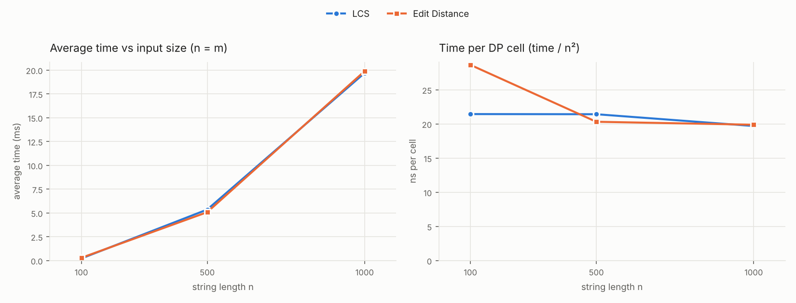
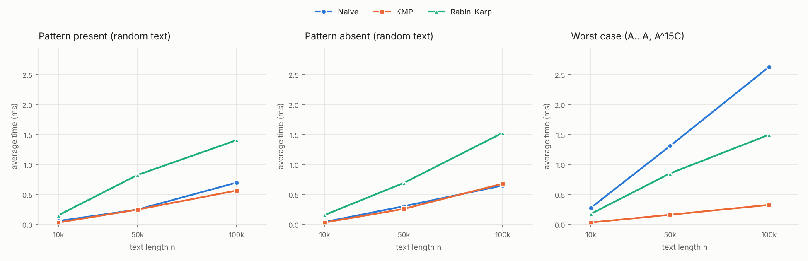
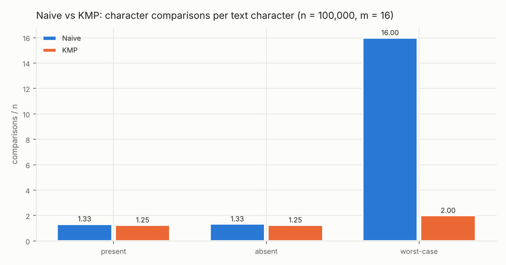
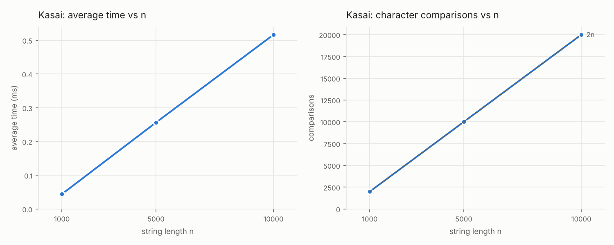

# Assignment 4 — Text Analysis: Dynamic Programming and String Algorithms

A Java 17 application that implements, tests and benchmarks six text-processing algorithms:

| Part | Algorithm | Class |
|---|---|---|
| A. Dynamic programming | Longest Common Subsequence (LCS) | `textanalysis.dp.LongestCommonSubsequence` |
| A. Dynamic programming | Edit (Levenshtein) Distance | `textanalysis.dp.EditDistance` |
| B. String matching | Naive matching | `textanalysis.matching.NaiveMatcher` |
| B. String matching | Knuth–Morris–Pratt (KMP) | `textanalysis.matching.KMPMatcher` |
| B. String matching | Rabin–Karp | `textanalysis.matching.RabinKarpMatcher` |
| C. Advanced | Kasai's LCP array | `textanalysis.suffix.KasaiLCP` |

All algorithms are written from scratch. No library method is used to do the actual work (no `String.indexOf`, `contains`, `regionMatches`, library suffix arrays, etc.). The standard library is used only for random data generation, collections, timing and file output.

---

## Contents

1. [Problem description and algorithm overview](#1-problem-description-and-algorithm-overview)
2. [Implementation decisions and assumptions](#2-implementation-decisions-and-assumptions)
3. [Complexity analysis](#3-complexity-analysis)
4. [Testing strategy and results](#4-testing-strategy-and-results)
5. [Experimental setup](#5-experimental-setup)
6. [Results: tables and plots](#6-results-tables-and-plots)
7. [Discussion: theory vs experiment](#7-discussion-theory-vs-experiment)
8. [Conclusion and trade-offs](#8-conclusion-and-trade-offs)
9. [How to build and run](#9-how-to-build-and-run)
10. [Repository structure and Git workflow](#10-repository-structure-and-git-workflow)

---

## 1. Problem description and algorithm overview

The goal is to analyse text with two families of algorithms: **dynamic programming** for comparing two strings, and **string matching** for locating a pattern inside a long text. A third part builds the **LCP array** of a string from its suffix array. Every algorithm is analysed theoretically and then measured on fixed workloads.

### 1.1 Longest Common Subsequence

Given strings `a` (length n) and `b` (length m), find the length of the longest sequence of characters that appears in both strings in the same relative order, not necessarily contiguously. Example: `LCS("ABCBDAB", "BDCABA") = 4` (one LCS is `BCBA`).

**Subproblem.** `L[i][j]` = length of the LCS of the prefixes `a[0..i)` and `b[0..j)`.

**Base cases.** `L[0][j] = 0` and `L[i][0] = 0`: an empty prefix has no common subsequence with anything.

**Recurrence.**

```
L[i][j] = L[i-1][j-1] + 1                  if a[i-1] == b[j-1]
L[i][j] = max(L[i-1][j], L[i][j-1])        otherwise
```

**Why it is correct.** Look at the last characters of the two prefixes.

* If `a[i-1] == b[j-1]`, some optimal common subsequence ends with that character. Any optimal solution that does not use it can be changed to use it (replace its last character with this pair) without becoming shorter. Removing this matched pair leaves a common subsequence of `a[0..i-1)` and `b[0..j-1)`, which must itself be optimal (optimal substructure), so the answer is `L[i-1][j-1] + 1`.
* If they differ, the two last characters cannot both be the final character of the same common subsequence. So at least one of them is unused, and the optimum is the best of dropping `a[i-1]` (`L[i-1][j]`) or dropping `b[j-1]` (`L[i][j-1]`).

Both cases only look at cells with a smaller `i`, a smaller `j`, or both, so filling the table row by row from `(1,1)` to `(n,m)` always reads already-computed values. The answer is `L[n][m]`. `subsequence(a, b)` walks back from `(n, m)` through the table to reconstruct one actual LCS.

### 1.2 Edit Distance (Levenshtein)

Find the minimum number of single-character **insertions, deletions and substitutions** that turn `source` (length n) into `target` (length m). Example: `kitten → sitting` needs 3 operations (k→s, e→i, insert g).

**Subproblem.** `D[i][j]` = edit distance between `source[0..i)` and `target[0..j)`.

**Base cases.** `D[i][0] = i` (delete all i characters) and `D[0][j] = j` (insert all j characters).

**Recurrence.**

```
cost    = 0 if source[i-1] == target[j-1] else 1
D[i][j] = min( D[i-1][j-1] + cost,     substitute (or keep, if cost = 0)
               D[i-1][j]   + 1,        delete source[i-1]
               D[i][j-1]   + 1 )       insert target[j-1]
```

**Why it is correct.** Consider an optimal edit script and what happens to the last position of the two prefixes. Exactly one of three things is true: `source[i-1]` is aligned with `target[j-1]` (kept for free or substituted for 1), `source[i-1]` is deleted, or `target[j-1]` is inserted. In each case, the rest of the script is an edit script for the shorter prefixes and must be optimal for them, otherwise the whole script could be improved. Taking the minimum over the three cases therefore gives the optimum. The answer is `D[n][m]`.

### 1.3 Naive string matching

For every shift `s = 0 .. n−m`, compare `pattern` with `text[s .. s+m)` character by character, stopping at the first mismatch. Report `s` if all m characters match. Simple, no preprocessing, but it forgets everything it learned at the previous shift.

### 1.4 Knuth–Morris–Pratt (KMP)

**Preprocessing — the LPS table.** `lps[q]` = length of the longest *proper* prefix of `pattern[0..q]` that is also a suffix of it. Example: `lps("ABABCABAB") = [0, 0, 1, 2, 0, 1, 2, 3, 4]`. It is built in one left-to-right pass: if the next character extends the current border, `length++`; otherwise fall back to `lps[length-1]` and try again.

**Search.** Keep `j` = number of pattern characters currently matched. For each text character `c`:

* if `c == pattern[j]`, advance `j`;
* if not and `j > 0`, set `j = lps[j-1]` and compare again; if `j == 0`, move on to the next text character;
* when `j == m`, report a match at `i − m + 1` and continue with `j = lps[m-1]`, so overlapping matches are found.

**How KMP avoids repeated comparisons.** After a mismatch at pattern position `j`, the naive algorithm moves the window one step and re-reads `j−1` text characters it has already seen. KMP knows those characters: they are exactly `pattern[0..j)`. The longest border of that prefix (`lps[j-1]`) tells it how far the pattern can be shifted while keeping a part that is already known to match, so the text pointer `i` **never moves backwards**. Each text character is read once as "new", and every extra comparison on a mismatch is paid for by a previous increase of `j`. This gives at most `2n` comparisons in the search phase, which the worst-case experiment confirms exactly (Section 6).

### 1.5 Rabin–Karp

Treat a string of length m as a number in base `B = 256` and take it modulo a prime `q = 1,000,000,007`:

```
h(x[0..m)) = (x[0]·B^(m-1) + x[1]·B^(m-2) + ... + x[m-1]) mod q
```

Compute the hash of the pattern and of the first window. Then **roll** the window one position in O(1):

```
h_next = ((h − text[s]·B^(m-1)) · B + text[s+m]) mod q
```

Only when the window hash equals the pattern hash are the characters compared.

**How Rabin–Karp handles hash collisions.** Equal hashes do **not** prove equal strings, because many strings map to the same residue mod q. Every hash hit is therefore **verified character by character** before the shift is reported. A hit that fails verification is a *spurious hit* (collision) and is counted in `getHashCollisions()`. This makes the algorithm always correct (Las Vegas style): collisions can only cost time, never produce a wrong answer. A large prime modulus makes collisions rare (probability about 1/q per window for non-adversarial input). The test suite deliberately uses a tiny modulus (q = 3, q = 7) to force many collisions and checks that the output is still exactly correct.

All intermediate values stay below `2^63`: `q < 2^31`, `B ≤ 256` and `char ≤ 65535`, so `h·B` and `char·B^(m-1) mod q` never overflow a `long`.

### 1.6 Kasai's algorithm for the LCP array

The **suffix array** `SA` lists the starting positions of all suffixes of `s` in lexicographic order. The **LCP array** stores, for each `i ≥ 1`, the length of the longest common prefix of the two **neighbouring** suffixes in that order:

```
LCP[i] = lcp( s[SA[i-1]..], s[SA[i]..] ),   LCP[0] = 0 by convention
```

**What the LCP array represents.** Because the suffixes are sorted, suffixes sharing a long prefix sit next to each other, so the LCP array summarises all repeated substrings of the text: `max(LCP)` is the length of the longest repeated substring, the number of distinct substrings is `n(n+1)/2 − Σ LCP[i]`, and the LCP of any two suffixes is the minimum of LCP over the range between them. Together with the suffix array it gives most of the power of a suffix tree with much less memory.

Example for `banana`:

| i | SA[i] | suffix | LCP[i] |
|---:|---:|---|---:|
| 0 | 5 | a | 0 |
| 1 | 3 | ana | 1 |
| 2 | 1 | anana | 3 |
| 3 | 0 | banana | 0 |
| 4 | 4 | na | 0 |
| 5 | 2 | nana | 2 |

**The algorithm.** Build `rank` (the inverse of SA). Process suffixes in **text order** `i = 0, 1, ..., n−1`, not in SA order. For suffix `i`, let `j = SA[rank[i] − 1]` be the suffix just before it in sorted order, and extend the common prefix starting from the current value `k`. Store `LCP[rank[i]] = k`, then decrease `k` by one before moving to `i+1`.

**Why `k` can start from `k − 1`.** If suffix `i` shares `k > 0` characters with its predecessor `j`, then removing the first character shows that suffix `i+1` shares `k−1` characters with suffix `j+1`, and `j+1` sorts before `i+1`. Every suffix between them in sorted order must also share at least those `k−1` characters with `i+1`, in particular its direct predecessor. So the LCP for `i+1` is at least `k−1`, and comparing can resume from there.

**Suffix array input.** The assignment does not require suffix-array construction. `SuffixArrayBuilder.build` is a simple helper (sort all suffix indices with a character-by-character comparator) used only to prepare inputs. It is **not** timed. For `banana` and `mississippi` the tests pass a hand-written, manually verified suffix array directly to Kasai.

---

## 2. Implementation decisions and assumptions

* **Language and build.** Java 17 (`javac --release 17`), no external dependencies. Tests use a small self-written runner (`TestRunner`) instead of JUnit, so the project compiles and runs with only a JDK.
* **Classes with counters.** Each algorithm is a small class that also records an operation count for the last call: DP cells filled (`getCellsComputed`), character comparisons (`getComparisons`), preprocessing operations (`getPreprocessingOperations`), Rabin–Karp hash hits and collisions, Kasai comparisons. The counters are simple `long` increments and are the same in tests and benchmarks.
* **Common interface.** `NaiveMatcher`, `KMPMatcher` and `RabinKarpMatcher` implement `StringMatcher`, so tests and benchmarks run the same loop over all three and compare their outputs directly.
* **Return values.** Matchers return a `List<Integer>` of **all** starting indices (0-based, increasing order). Overlapping occurrences are reported (`"aaaaa"`, `"aa"` → `[0, 1, 2, 3]`).
* **Empty pattern.** An empty pattern returns an **empty list** in all three matchers. Mathematically the empty string occurs at every position `0..n`, but such a result is not useful for text search and would make "number of occurrences" depend on the text length rather than on the pattern. The choice is the same in all matchers and is covered by tests.
* **Pattern longer than the text** returns an empty list without doing any work. An empty text returns an empty list.
* **`null` input** throws `NullPointerException` with the parameter name (fail fast).
* **DP tables.** LCS and Edit Distance keep the full `(n+1) × (m+1)` table, because it is needed to reconstruct the LCS and to explain the recurrence at the defence. Only the length/distance is required, so a two-row O(min(n, m)) space version is possible; this trade-off is discussed in Section 8.
* **Rabin–Karp parameters.** Base `256`, modulus `1,000,000,007` (prime). Another base/modulus can be passed to the constructor; this is used in tests to force collisions. Comparisons counted for Rabin–Karp are only the character comparisons of the **verification step**; hash computation is reported separately (m preprocessing steps plus one O(1) roll per shift).
* **Kasai input checks.** `KasaiLCP.build` rejects a suffix array of the wrong length or one that is not a permutation of `0..n−1`. `LCP[0] = 0` by convention.
* **No comments in source code**, by choice: names of classes, methods and variables are written to be self-explanatory, and this README contains the full explanation.

---

## 3. Complexity analysis

n = text / first string length, m = pattern / second string length, k = number of occurrences of the pattern. Auxiliary space excludes the input strings and the returned list of occurrences (which is O(k)).

| Algorithm | Main operation / recurrence | Best-case time | Worst-case time | Auxiliary space | Justification |
|---|---|---|---|---|---|
| **LCS** | `L[i][j] = L[i-1][j-1]+1` if equal, else `max(L[i-1][j], L[i][j-1])` | Θ(n·m) | Θ(n·m) | Θ(n·m) | Every one of the n·m cells is filled exactly once with O(1) work, regardless of the input. Table has (n+1)(m+1) ints. Reconstruction adds O(n+m). |
| **Edit Distance** | `D[i][j] = min(D[i-1][j-1]+cost, D[i-1][j]+1, D[i][j-1]+1)` | Θ(n·m) | Θ(n·m) | Θ(n·m) | Same table shape: n·m cells, each a min of 3 values. Base row/column add O(n+m). |
| **Naive** | compare `pattern[j]` with `text[s+j]` for every shift s | Θ(n) (first character mismatches at every shift; n−m+1 comparisons) | Θ((n−m+1)·m) = O(n·m) (e.g. `A…A` vs `A…AC`: m comparisons at every shift) | Θ(1) | n−m+1 shifts, each costing between 1 and m comparisons. No preprocessing. |
| **KMP — preprocessing** | LPS: extend border or fall back to `lps[len-1]` | Θ(m) | Θ(m) | Θ(m) | `i` increases m−1 times; each fallback strictly decreases `len`, which only grows with `i`, so ≤ 2m comparisons in total. |
| **KMP — search** | match → `j++`; mismatch → `j = lps[j-1]` | Θ(n) | Θ(n) | Θ(m) for the LPS table | The text pointer never moves back. Every fallback decreases `j`, and `j` grows at most once per text character, so ≤ 2n comparisons. **Total Θ(n + m)**. |
| **Rabin–Karp — preprocessing** | `h = (h·B + c) mod q` for pattern and first window, plus `B^(m-1)` | Θ(m) | Θ(m) | Θ(1) | One pass over m characters. |
| **Rabin–Karp — search** | rolling hash `((h − c_out·B^(m-1))·B + c_in) mod q`, verify on hash hit | Θ(n) (no hash hits) | Θ((n−m+1)·m) = O(n·m) | Θ(1) | n−m+1 O(1) rolls. Each hash hit costs up to m comparisons. **Expected** Θ(n + m + k·m) with a good prime modulus (spurious hits ≈ (n−m+1)/q). **Worst case** O(n·m) when (almost) every window hits: many real matches (`A…A` vs `A…A`) or many collisions (bad/tiny modulus, adversarial input). |
| **Kasai LCP** | `k` = LCP of suffix i and its SA predecessor; `k` starts from previous `k − 1` | Θ(n) | Θ(n) | Θ(n) (`rank` array; plus the n-element LCP output) | `k` never exceeds n and decreases by at most 1 per step (≤ n decreases), so it increases at most 2n times in total; plus ≤ n mismatching comparisons → **≤ 3n comparisons**. Building `rank` is Θ(n). |
| *Suffix array helper (not timed, not required)* | sort suffix indices with char-by-char comparator | Θ(n log n) | O(n² log n) | Θ(n) | O(n log n) comparisons, each up to O(n) characters. Fast for random text (short common prefixes). |

**Theoretical vs measured.** The table above gives asymptotic bounds on the number of basic operations. Execution time also depends on constants hidden by Big-O: memory access patterns, the cost of `%` on `long`, JIT compilation, garbage collection and CPU caches. Section 6 reports both **operation counts** (directly comparable with the bounds above) and **wall-clock time** (which also includes those constants). Section 7 discusses where the two agree and where they differ.

**Expected vs worst case.** Only Rabin–Karp has different expected and worst-case bounds: its expected O(n + m) relies on hash hits being rare, which is a probabilistic property of the hash and the input, not a guarantee. Naive also differs between best and worst case, but that depends on the input structure, not on probability. KMP, LCS, Edit Distance and Kasai have the same bound for every input.

---

## 4. Testing strategy and results

Tests are in `src/test/java/textanalysis/TestRunner.java` and run with `./run.sh test` (or `run.bat test`). The runner exits with code 1 if any check fails.

The strategy has three layers:

1. **Required edge cases** with hand-computed expected answers.
2. **Cross-checks between implementations**: for every string-matching case, Naive, KMP and Rabin–Karp must return **the same list** and it must equal the expected list.
3. **Randomized checks against independent oracles**: brute-force LCS (enumerate all subsequences), bounds that any edit distance must satisfy, a simple position-by-position matching oracle, and a brute-force LCP computed directly from the suffix array.

| Group | Cases |
|---|---|
| LCS | identical strings (`ABCDEF` → 6); completely different (`ABC`/`XYZ` → 0); empty first, empty second, both empty (→ 0); classic examples (`ABCBDAB`/`BDCABA` → 4, `AGGTAB`/`GXTXAYB` → 4); symmetry; reconstructed LCS has optimal length and is a subsequence of both; cells = n·m; 300 random pairs vs brute force |
| Edit Distance | identical (→ 0); one empty string (`""`→`abc` = 3 insertions, `abc`→`""` = 3 deletions); both empty; **substitution** `cat→cut` = 1; **insertion** `cat→cart` = 1; **deletion** `cart→cat` = 1; `kitten→sitting` = 3; `sunday→saturday` = 3; `intention→execution` = 5; symmetry; 300 random pairs satisfy `|n−m| ≤ d ≤ max(n,m)` and `d ≤ n+m−2·LCS` |
| KMP LPS table | `AABAACAABAA`, `ABABCABAB`, `AAAA`, `ABCD` |
| String matching (all 3 must agree) | pattern at the **beginning**, **middle**, **end**; **multiple** occurrences; overlapping occurrences (`aaaaa`/`aa`, `abababab`/`abab`); pattern **absent**; pattern **longer than the text**; **empty pattern**; empty text; empty text and empty pattern; pattern equals text; single-character pattern; near-miss at the end |
| Rabin–Karp collisions | modulus 3 still returns the correct positions; it produces spurious hits; hash hits = true matches + collisions; the default modulus has far fewer collisions |
| Randomized matching | 500 random text/pattern pairs over `{A, B}`; Naive, KMP, Rabin–Karp (default) and Rabin–Karp (base 31, mod 7) all equal the oracle |
| Kasai | `banana` and `mississippi` with **manually verified** suffix arrays and expected LCP arrays (see Section 1.6 for `banana`); the SA helper reproduces those manual SAs; single character; empty string; `aaaa` → `[0,1,2,3]`; rejects an invalid SA; 200 random strings vs brute-force LCP; comparisons never exceed 3n |

Manual check for `mississippi`:

| i | SA[i] | suffix | LCP[i] |
|---:|---:|---|---:|
| 0 | 10 | i | 0 |
| 1 | 7 | ippi | 1 |
| 2 | 4 | issippi | 1 |
| 3 | 1 | ississippi | 4 |
| 4 | 0 | mississippi | 0 |
| 5 | 9 | pi | 0 |
| 6 | 8 | ppi | 1 |
| 7 | 6 | sippi | 0 |
| 8 | 3 | sissippi | 2 |
| 9 | 5 | ssippi | 1 |
| 10 | 2 | ssissippi | 3 |

**Result: 59 checks, 59 passed, 0 failed.**

```
[LCS]                                        13 passed
[Edit Distance]                              13 passed
[KMP LPS table]                               4 passed
[String matching (Naive, KMP, Rabin-Karp)]   14 passed
[Rabin-Karp hash collisions]                  4 passed
[Randomized cross-check]                      1 passed
[Kasai LCP]                                  10 passed
Total: 59 passed, 0 failed
```

In addition, the benchmark itself checks on every workload that KMP and Rabin–Karp return exactly the same occurrence list as Naive and stops with an error otherwise.

---

## 5. Experimental setup

**Environment of the reported run:** OpenJDK 21.0.12 (compiled with `--release 17`), Linux x86-64, JVM option `-Xms512m`. Absolute times depend on the machine; ratios and operation counts are what matter for the comparison.

**Alphabet.** All random strings use the 4-letter DNA alphabet **`{A, C, G, T}`** (`RandomStrings.ALPHABET`), chosen uniformly at random. A small alphabet is realistic for text such as DNA and gives a fair number of partial matches, which makes the matching algorithms do non-trivial work.

**Random seed.** `java.util.Random` with fixed seeds: 42 for Part A, 43 for Part B, 44 for Part C (`RandomStrings.SEED` + offset), 142 for the global warm-up. Re-running gives exactly the same inputs, results and operation counts.

**Workloads.**

| Experiment | Input | Sizes |
|---|---|---|
| LCS | two independent random strings, both of length n | n = 100, 500, 1,000 |
| Edit Distance | the **same** two strings as LCS for each n | n = 100, 500, 1,000 |
| String matching — *present* | random text; pattern = `text[n/2 .. n/2+16)` (occurs at least once) | n = 10,000, 50,000, 100,000; m = 16 |
| String matching — *absent* | same random text; random pattern of length 16, regenerated until Naive confirms it does not occur (outside timing) | same |
| String matching — *worst case* (extra) | text `A…A` (n characters), pattern `A^15 C` | same |
| Kasai | random string of length n; suffix array built **before** timing | n = 1,000, 5,000, 10,000 |

For each matching scenario, **the same text and the same pattern** are given to Naive, KMP and Rabin–Karp. The extra worst-case scenario is not required by the assignment; it is added because random text never shows the difference between O(n·m) and O(n + m).

**Timing methodology.**

1. **Global warm-up:** before any measurement, every algorithm runs 200 times on medium-size inputs so that the JIT compiler has optimised all hot methods.
2. **Per-measurement warm-up:** 10 untimed runs on the exact input.
3. **5 timed runs**, each measured with `System.nanoTime()` immediately before and after the single algorithm call. The table reports the **average** of the 5 runs (and min/max to show the spread).
4. **Excluded from timed regions:** input generation, suffix-array construction, choosing the absent pattern, console output, CSV writing, and the extra call used to read operation counts.
5. Each result is added to a `sink` variable that is used at the end, so the JIT cannot remove the call as dead code.
6. `-Xms512m` fixes the initial heap so that heap resizing does not add noise to the DP measurements (a 1001×1001 `int` table is about 4 MB).

**Operation counts recorded.** DP: cells filled (= n·m). Matching: character comparisons in the search phase, preprocessing operations (LPS comparisons for KMP, hashed characters for Rabin–Karp), hash collisions. Kasai: character comparisons.

Raw results: [`results/dp_results.csv`](results/dp_results.csv), [`results/matching_results.csv`](results/matching_results.csv), [`results/kasai_results.csv`](results/kasai_results.csv). Plots are created from these CSV files by [`scripts/plot_results.py`](scripts/plot_results.py) (Python 3 + matplotlib).

---

## 6. Results: tables and plots

### 6.1 Part A — LCS and Edit Distance

| Algorithm | n = m | Result | DP cells | Avg time (ms) | Min (ms) | Max (ms) | ns / cell |
|---|---:|---:|---:|---:|---:|---:|---:|
| LCS | 100 | 64 | 10,000 | 0.214 | 0.186 | 0.266 | 21.4 |
| Edit Distance | 100 | 55 | 10,000 | 0.286 | 0.273 | 0.301 | 28.6 |
| LCS | 500 | 326 | 250,000 | 5.356 | 5.153 | 5.564 | 21.4 |
| Edit Distance | 500 | 267 | 250,000 | 5.080 | 4.640 | 5.566 | 20.3 |
| LCS | 1,000 | 648 | 1,000,000 | 19.696 | 18.239 | 21.610 | 19.7 |
| Edit Distance | 1,000 | 521 | 1,000,000 | 19.886 | 19.335 | 20.293 | 19.9 |



### 6.2 Part B — Naive vs KMP vs Rabin–Karp (pattern length m = 16)

| Scenario | Text length n | Algorithm | Occurrences | Char comparisons | Comparisons / n | Preproc. ops | Hash collisions | Avg time (ms) | Min (ms) | Max (ms) |
|---|---:|---|---:|---:|---:|---:|---:|---:|---:|---:|
| present | 10,000 | Naive | 1 | 13,372 | 1.34 | 0 | 0 | 0.058 | 0.052 | 0.067 |
| present | 10,000 | KMP | 1 | 12,522 | 1.25 | 20 | 0 | 0.031 | 0.026 | 0.044 |
| present | 10,000 | Rabin-Karp | 1 | 16 | 0.00 | 16 | 0 | 0.153 | 0.147 | 0.176 |
| absent | 10,000 | Naive | 0 | 13,342 | 1.33 | 0 | 0 | 0.042 | 0.039 | 0.051 |
| absent | 10,000 | KMP | 0 | 12,360 | 1.24 | 20 | 0 | 0.032 | 0.024 | 0.046 |
| absent | 10,000 | Rabin-Karp | 0 | 0 | 0.00 | 16 | 0 | 0.158 | 0.149 | 0.169 |
| worst-case | 10,000 | Naive | 0 | 159,760 | 15.98 | 0 | 0 | 0.278 | 0.260 | 0.303 |
| worst-case | 10,000 | KMP | 0 | 19,985 | 2.00 | 29 | 0 | 0.032 | 0.031 | 0.035 |
| worst-case | 10,000 | Rabin-Karp | 0 | 0 | 0.00 | 16 | 0 | 0.176 | 0.172 | 0.184 |
| present | 50,000 | Naive | 1 | 66,597 | 1.33 | 0 | 0 | 0.248 | 0.239 | 0.262 |
| present | 50,000 | KMP | 1 | 62,101 | 1.24 | 20 | 0 | 0.248 | 0.237 | 0.274 |
| present | 50,000 | Rabin-Karp | 1 | 16 | 0.00 | 16 | 0 | 0.826 | 0.773 | 0.880 |
| absent | 50,000 | Naive | 0 | 66,578 | 1.33 | 0 | 0 | 0.303 | 0.293 | 0.321 |
| absent | 50,000 | KMP | 0 | 62,317 | 1.25 | 18 | 0 | 0.259 | 0.241 | 0.274 |
| absent | 50,000 | Rabin-Karp | 0 | 0 | 0.00 | 16 | 0 | 0.692 | 0.670 | 0.713 |
| worst-case | 50,000 | Naive | 0 | 799,760 | 16.00 | 0 | 0 | 1.309 | 1.275 | 1.333 |
| worst-case | 50,000 | KMP | 0 | 99,985 | 2.00 | 29 | 0 | 0.162 | 0.151 | 0.179 |
| worst-case | 50,000 | Rabin-Karp | 0 | 0 | 0.00 | 16 | 0 | 0.851 | 0.842 | 0.864 |
| present | 100,000 | Naive | 1 | 133,292 | 1.33 | 0 | 0 | 0.698 | 0.652 | 0.821 |
| present | 100,000 | KMP | 1 | 125,061 | 1.25 | 17 | 0 | 0.565 | 0.541 | 0.589 |
| present | 100,000 | Rabin-Karp | 1 | 16 | 0.00 | 16 | 0 | 1.405 | 1.358 | 1.469 |
| absent | 100,000 | Naive | 0 | 133,452 | 1.33 | 0 | 0 | 0.650 | 0.623 | 0.683 |
| absent | 100,000 | KMP | 0 | 124,957 | 1.25 | 18 | 0 | 0.680 | 0.633 | 0.755 |
| absent | 100,000 | Rabin-Karp | 0 | 0 | 0.00 | 16 | 0 | 1.529 | 1.495 | 1.572 |
| worst-case | 100,000 | Naive | 0 | 1,599,760 | 16.00 | 0 | 0 | 2.628 | 2.449 | 2.695 |
| worst-case | 100,000 | KMP | 0 | 199,985 | 2.00 | 29 | 0 | 0.326 | 0.301 | 0.357 |
| worst-case | 100,000 | Rabin-Karp | 0 | 0 | 0.00 | 16 | 0 | 1.496 | 1.475 | 1.510 |

For Rabin–Karp, "char comparisons" counts only verification of hash hits. Its main work is the n − m rolling-hash updates per search (99,984 for n = 100,000), which are not character comparisons.





### 6.3 Part C — Kasai's LCP algorithm

| n | Max LCP | Char comparisons | Comparisons / n | Avg time (ms) | Min (ms) | Max (ms) |
|---:|---:|---:|---:|---:|---:|---:|
| 1,000 | 8 | 1,990 | 1.99 | 0.0440 | 0.0369 | 0.0545 |
| 5,000 | 11 | 9,989 | 2.00 | 0.2560 | 0.2415 | 0.2918 |
| 10,000 | 12 | 19,989 | 2.00 | 0.5163 | 0.4980 | 0.5377 |



The dashed `2n` reference line in the right panel lies almost exactly under the measured points.

---

## 7. Discussion: theory vs experiment

### 7.1 Dynamic programming: clear quadratic growth

* Operation counts match the theory **exactly**: both algorithms fill n² cells (10⁴, 2.5·10⁵, 10⁶) independent of the string contents.
* Time follows the same curve. Going from n = 500 to n = 1,000 (2× n, 4× cells) multiplies time by **3.7** for LCS and **3.9** for Edit Distance, close to the predicted 4. From n = 100 to 1,000 (10× n) time grows about **92×** and **69×**, close to the predicted 100.
* The right panel of the DP plot shows **time per cell** settling at about **20 ns** for both algorithms. A constant time per cell is exactly what Θ(n·m) predicts. The higher value for Edit Distance at n = 100 comes from the extra fixed costs (allocating the table and initialising the first row and column), which are a large share of a 0.3 ms run and become negligible for larger n.
* LCS and Edit Distance take almost the same time even though Edit Distance computes a minimum of three values per cell and LCS a maximum of two. Both are limited mainly by memory traffic over a (n+1)×(m+1) `int` table (4 MB for n = 1,000), not by the arithmetic.
* Results are also consistent with each other: for each n, `ED ≥ n − LCS` (e.g. n = 1,000: 521 ≥ 1000 − 648 = 352), as it must be because each unmatched character needs at least one operation.

### 7.2 String matching on random text: theory says "different", practice says "similar"

* With a 4-letter alphabet, a random position matches the pattern's first character with probability 1/4, so the naive algorithm expects `1 + 1/4 + 1/16 + … ≈ 4/3` comparisons per shift. The measured **1.33 comparisons per character** matches this exactly. So on random text, Naive is effectively **linear** — its O(n·m) worst case simply does not occur.
* KMP needs **1.25** comparisons per character: slightly fewer, because it never re-reads text characters, but the difference is small. At n = 50,000 and 100,000 the times of Naive and KMP are within about 20 % of each other, and both grow roughly linearly (×2.1–2.8 from 50k to 100k). At n = 10,000 a run takes only 30–60 µs, so small fixed costs make the relative gap look larger.
* **Rabin–Karp is the slowest on random text** (2.3–2.5× slower than KMP at n = 100,000, and more at smaller n) even though it performs **zero** comparisons when the pattern is absent. Both are Θ(n + m), but Rabin–Karp's constant is larger: every shift does a multiplication and two `%` operations on `long` values, and integer division is much more expensive than comparing two `char`s that are already in cache. This is a clear case where the same Big-O hides different constant factors.
* **Hash collisions: 0** in every experiment with the prime modulus 1,000,000,007, so verification cost was only the 16 comparisons for the single real match. The tests show the opposite situation: with modulus 3 many spurious hits occur, yet the output stays correct because every hit is verified.

### 7.3 String matching worst case: the theory becomes visible

* On `A…A` with pattern `A^15C`, every shift matches 15 characters before failing, so Naive performs **exactly (n − m + 1)·m** comparisons (1,599,760 = 99,985 × 16) — **16 per character = m**, the Θ(n·m) worst case.
* KMP performs **199,985 ≈ 2n** comparisons, exactly the upper bound proved in Section 3. It is **8× faster** than Naive at n = 100,000 (0.33 ms vs 2.63 ms), and the gap would grow linearly with m.
* Rabin–Karp's time does not change between scenarios (≈1.5 ms at n = 100,000): the window hash of `A^16` never equals the hash of `A^15C`, so it never verifies anything. Its cost depends on the number of shifts, not on how similar the text is to the pattern. (Its own worst case needs many hash hits, e.g. pattern `A^16` in `A…A`, which reports almost n matches.)
* The 10k-to-50k step sometimes grows by more than 5× (for example KMP 0.031 → 0.248 ms on *present*). At n = 10,000 the text (20 KB) fits in the fastest CPU cache and runs take only ~30 µs, where timer resolution and cache effects are a large share. From 50k to 100k all algorithms scale by ≈2×, as expected for linear algorithms.

### 7.4 Kasai: linear with a constant of 2

* Character comparisons are **1.99n–2.00n**, under the theoretical ≤ 3n bound, and time grows linearly: ×5.8 from 1k to 5k and ×2.0 from 5k to 10k.
* The constant 2 has a simple explanation for random text: LCP values are small (the maximum is only 8–12), so for most suffixes Kasai does one successful comparison (carrying `k` from the previous suffix) and one mismatch.
* Kasai is very cheap compared with everything else: 0.5 ms for n = 10,000. In a real system the suffix-array construction (not timed here) would dominate.

---

## 8. Conclusion and trade-offs

* **LCS / Edit Distance.** Both are Θ(n·m) in time **and** space, and the experiments confirm a steady ~20 ns per cell. They are practical up to a few thousand characters per string. The main trade-off is memory: keeping the full table allows reconstructing the actual subsequence or edit script and explaining the result; if only the number is needed, keeping two rows reduces space to O(min(n, m)) with the same running time.
* **Naive matching** is the simplest and, on random text with a non-tiny alphabet, about as fast as KMP. Its weakness is predictability: on repetitive input (DNA repeats, logs, `AAAA…`) it degrades to Θ(n·m), 8× slower than KMP already for m = 16.
* **KMP** has a **guaranteed** Θ(n + m) bound, never moves back in the text (so it works on streams), and was the fastest or tied for fastest in every scenario. The costs are an extra O(m) table and a slightly more complex implementation. It is the safest default for single-pattern search.
* **Rabin–Karp** is correct for every input because hash hits are verified, but its performance guarantee is only **expected**: a bad modulus or adversarial input can push it to Θ(n·m). Its per-character cost (modular arithmetic) is higher than KMP's, so it is the slowest here. Its real advantage, which this single-pattern experiment does not exercise, is searching for **many patterns of the same length at once** (one hash set lookup per window) and its extension to 2D/plagiarism detection.
* **Kasai** turns a suffix array into an LCP array in true linear time with ≈2n comparisons; it makes suffix arrays useful for repeated-substring and distinct-substring queries. The real bottleneck in a full pipeline is suffix-array construction, not Kasai.

**Overall:** asymptotic analysis correctly predicts growth rates (quadratic DP, linear KMP and Kasai, worst-case Naive), but on typical random inputs the constant factors decide which algorithm is fastest. Operation counts matched the theory almost exactly, while wall-clock times added the effects of memory, division cost and caches.

---

## 9. How to build and run

Requirements: **JDK 17 or newer**. Python 3 with `matplotlib` is needed only to regenerate the plots.

```bash
git clone https://github.com/igor2282/assignment4-text-analysis.git
cd assignment4-text-analysis

./run.sh test     # compile and run all 59 checks
./run.sh demo     # small demonstration of every algorithm
./run.sh bench    # run experiments, write results/*.csv
./run.sh plots    # regenerate plots/*.png from the CSV files
./run.sh          # all of the above
```

On Windows use `run.bat test`, `run.bat demo`, `run.bat bench`, `run.bat plots` or `run.bat`.

Manual commands (any OS):

```bash
javac --release 17 -d out src/main/java/textanalysis/*.java src/main/java/textanalysis/*/*.java src/test/java/textanalysis/*.java
java -cp out textanalysis.TestRunner
java -cp out textanalysis.Main
java -Xms512m -cp out textanalysis.bench.Benchmark results
python3 scripts/plot_results.py
```

In IntelliJ IDEA: mark `src/main/java` as *Sources Root* and `src/test/java` as *Test Sources Root*, then run `TestRunner`, `Main` or `Benchmark`.

---

## 10. Repository structure and Git workflow

```
assignment4-text-analysis/
├── README.md                         full report
├── run.sh / run.bat                  build, test, demo, benchmark, plots
├── src/main/java/textanalysis/
│   ├── Main.java                     demonstration
│   ├── dp/
│   │   ├── LongestCommonSubsequence.java
│   │   └── EditDistance.java
│   ├── matching/
│   │   ├── StringMatcher.java        common interface
│   │   ├── NaiveMatcher.java
│   │   ├── KMPMatcher.java
│   │   └── RabinKarpMatcher.java
│   ├── suffix/
│   │   ├── SuffixArrayBuilder.java   simple SA helper for inputs
│   │   └── KasaiLCP.java
│   ├── bench/Benchmark.java          experiments and CSV output
│   └── util/RandomStrings.java       seeded generator, alphabet ACGT
├── src/test/java/textanalysis/
│   └── TestRunner.java               all tests
├── scripts/plot_results.py           plots from CSV
├── results/                          dp_results.csv, matching_results.csv, kasai_results.csv
└── plots/                            dp_time_vs_n.png, matching_time_vs_text_length.png,
                                      matching_comparisons.png, kasai_time_vs_n.png
```

**Workflow.** Each part was developed on its own feature branch and merged into `main` with a merge commit, so the history shows the progress step by step:

| Branch | Content |
|---|---|
| `feature/dynamic-programming` | LCS and Edit Distance with tests |
| `feature/string-matching` | Naive, KMP, Rabin–Karp, common interface, tests |
| `feature/kasai-lcp` | suffix array helper, Kasai, tests |
| `feature/experiments` | seeded generator, benchmark harness, results, plots |
| `docs/report` | README report and run scripts |
